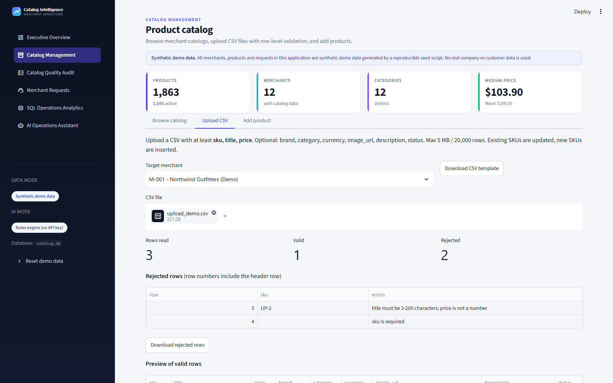
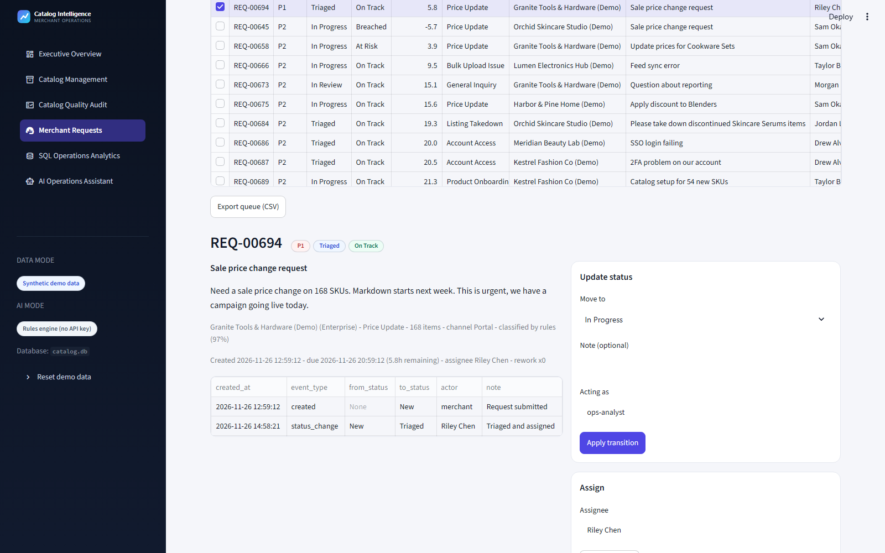
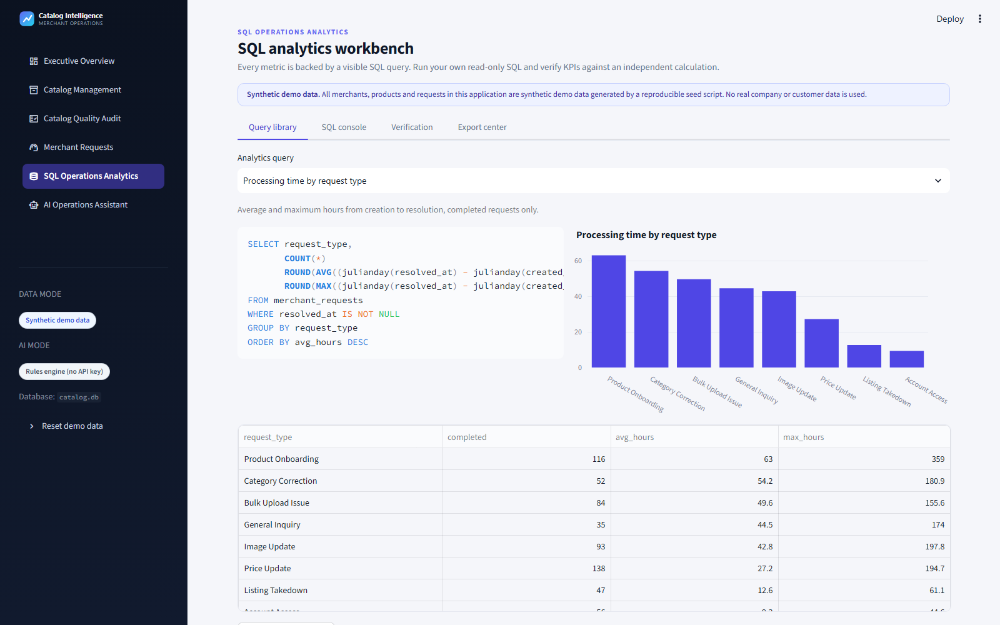
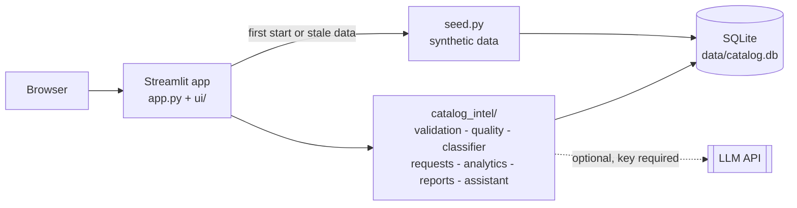

# Merchant Catalog Intelligence

An operations-management application for e-commerce marketplaces: it audits merchant product catalogs, triages merchant requests with AI-assisted classification, tracks SLAs and rework, and exposes every metric through transparent SQL.

> **All data is synthetic.** Merchants, products and requests are generated by a reproducible seed script (`scripts/seed_data.py`). No real company, customer or credential is used anywhere in this repository.

**Live demo:** not deployed yet (see [Deployment](#deployment-to-streamlit-community-cloud)).
**Repository:** https://github.com/purinLee/my-project

## Screenshots

Captured from the running application on freshly seeded synthetic data (`scripts/capture_screenshots.py`).

| Executive Overview | Catalog Quality Audit |
| --- | --- |
|  |  |

| Catalog Management - CSV validation | Merchant Requests - detail and lifecycle |
| --- | --- |
|  |  |

| New request - live classification | SQL Analytics - verification |
| --- | --- |
|  |  |

| SQL Analytics - query library | AI Operations Assistant |
| --- | --- |
|  |  |

More: [Catalog Management](docs/screenshots/02_catalog_management.png), [Merchant Requests queue](docs/screenshots/04_merchant_requests.png), [Assistant start](docs/screenshots/06_ai_assistant.png).

## Features

| Area | What it does |
| --- | --- |
| **Executive Overview** | KPI cards (open requests, SLA compliance, processing time, rework rate, breaches, catalog clean rate), rule-based insights, status funnel, weekly throughput, SLA by priority, P50/P90 processing time, rework by type, merchant leaderboard, HTML executive report. |
| **Catalog Management** | Filter/search/export the catalog; **CSV upload with row-level validation** (size, encoding, columns, SKU format, price, currency, duplicates in file); upsert import with upload history; single-product form. |
| **Catalog Quality Audit** | **Duplicate detection** (exact-after-normalisation and near-duplicate, same merchant), **price anomaly detection** (median/MAD z-score on log price per category, plus invalid prices), **missing image detection** (none / invalid URL / placeholder), incomplete metadata, per-product and per-merchant quality scores, adjustable thresholds, CSV export. |
| **Merchant Requests** | Queue with SLA state (On Track / At Risk / Breached / Met / Missed); **request classification** (8 types) and **priority recommendation** (P1-P4, with human-readable reasons); **lifecycle tracking** with enforced transitions and event timeline; assignment; rework counted when a request returns to *In Progress* after review/resolution. |
| **SQL Operations Analytics** | Query library (10 SQL queries shown next to results and charts), read-only SQL console, **verification tab** that reconciles SQL KPIs with an independent pandas calculation, integrity checks, export center (requests, SLA report, quality findings, executive report). |
| **AI Operations Assistant** | Chat over live analytics: summary, SLA risk, backlog, rework, processing time, duplicates, price anomalies, images, merchant quality, and `Classify: <text>` triage. Answers are grounded in SQL results and show their sources. |

### AI-assisted classification with a deterministic fallback

`classifier.classify_request()` tries an optional LLM (`catalog_intel/ai.py`, OpenAI-compatible, standard library only) **only if** `OPENAI_API_KEY` is configured. The model output is strictly validated (allowed type, confidence in 0-1); any missing key, network error, timeout or malformed output falls back to the deterministic keyword-scoring model. With no key the app is fully functional and the sidebar shows **Rules engine (no API key)**. The LLM path is covered by unit tests with a mocked transport; it has **not** been exercised against a live provider.

### Business definitions

| Metric | Definition |
| --- | --- |
| SLA window | P1 8h, P2 24h, P3 72h, P4 120h from creation (calendar hours, clock not paused while waiting on merchant). |
| SLA compliance | Completed requests with `resolved_at <= due_at` / all completed requests. |
| Open SLA state | *Breached* past due; *At Risk* with < 25% of the window left; otherwise *On Track*. |
| Processing time | `resolved_at - created_at` for completed (Resolved/Closed) requests. Rejected requests are excluded. |
| Rework rate | Completed requests with `rework_count > 0` / completed requests. |
| Priority score | Type base + urgency keywords (capped at 3) + merchant tier + affected-item volume; >=7 P1, >=5 P2, >=3 P3, else P4. |

## Architecture

See [docs/architecture.md](docs/architecture.md) for the full diagrams (components, ER model, lifecycle).



```
app.py                  Streamlit entry point (st.navigation, theme, sidebar)
ui/                     One module per page + shared theme/components
catalog_intel/          Business logic - no Streamlit imports, fully unit-tested
  config.py db.py seed.py validation.py quality.py classifier.py ai.py
  requests_mgmt.py analytics.py reports.py assistant.py
scripts/seed_data.py    Reproducible seed CLI;  scripts/capture_screenshots.py
tests/                  pytest suite (logic, SQL verification, UI smoke tests)
.streamlit/             config.toml (theme) + secrets.toml.example
```

## Run locally

Requires Python 3.10+.

```bash
python -m venv .venv
.venv/Scripts/activate            # Windows (Git Bash: source .venv/Scripts/activate); macOS/Linux: source .venv/bin/activate
pip install -r requirements.txt
streamlit run app.py
```

The first start creates `data/catalog.db` and seeds it automatically (about 1,900 products, 700 requests, 12 merchants). The demo data is refreshed automatically when it is more than 3 days old, so open requests are always measured against a realistic "now". Use **Reset demo data** in the sidebar to regenerate on demand.

### Seed script

```bash
python scripts/seed_data.py                                   # default seed, as-of now
python scripts/seed_data.py --seed 7 --as-of "2026-01-15 12:00:00" --db data/other.db
```

The same `(seed, as_of)` always produces byte-identical data (verified by a test). Defects (duplicates, price anomalies, missing images) are injected at known rates so the detectors can be scored against ground truth.

### Tests

```bash
pip install -r requirements-dev.txt
python -m pytest -q
```

The suite (119 tests) covers: classifier accuracy on labeled synthetic requests, LLM fallback and output validation, priority scoring, CSV validation edge cases, duplicate/price/image detectors (recall and precision against injected ground truth), lifecycle transitions and rework, SLA states, **SQL-vs-pandas reconciliation of every headline KPI**, SQL console safety, formula-injection-safe exports, seed reproducibility, and headless rendering of all six pages with Streamlit's `AppTest`.

## Security and data handling

- No credentials or secrets are committed. `.streamlit/secrets.toml` and `.env*` are git-ignored; only `secrets.toml.example` is tracked.
- All SQL uses bound parameters; the SQL console accepts a single `SELECT`/`WITH`, runs on a `mode=ro` connection with `PRAGMA query_only`, and caps results at 1,000 rows.
- Uploads: 5 MB / 20,000-row limits, control characters stripped, strict column/field validation.
- CSV exports escape cells beginning with `=`, `+`, `-`, `@` (spreadsheet formula injection). HTML report content is escaped.
- The demo has **no authentication by design** (public demonstration). Do not load real merchant data into a public deployment.

## Deployment to Streamlit Community Cloud

1. Push this repository to GitHub (public or private).
2. In [share.streamlit.io](https://share.streamlit.io) choose **Create app**, select the repository and branch, and set **Main file path** to `app.py`.
3. Python 3.10-3.12 works. Dependencies come from `requirements.txt`.
4. Secrets are **optional**. To enable the LLM path, paste into *App settings > Secrets*:
   ```toml
   OPENAI_API_KEY = "sk-..."
   ```
5. Deploy. The database is created and seeded on the first request; no manual step is needed. The filesystem on Community Cloud is ephemeral, so uploads and edits reset when the app restarts, which is appropriate for a demo.

## Known limitations

- SQLite on an ephemeral filesystem: data written through the UI is not durable on Streamlit Community Cloud, and concurrent writers are serialised.
- Duplicate detection works within a single merchant and compares titles only (no image or attribute matching).
- Price anomalies are detected per category with a statistical rule; legitimate premium/clearance products can be flagged.
- SLA uses calendar hours, with no business-hours calendar, holidays or pause-on-merchant-wait.
- The rule-based classifier is English-only and keyword-driven; accuracy is 100% on the synthetic labeled set (the seed templates share its vocabulary) and 16/16 on a small hand-written held-out set written by the same author. Both numbers are optimistic; real-world accuracy will be lower.
- The optional LLM integration is unit-tested with a mocked transport only.
- No authentication or per-user audit identity (the "acting as" field is free text).
