# Merchant Catalog Intelligence

An operations-management application for e-commerce marketplaces: it audits merchant product catalogs, triages merchant requests with rule-based (optionally LLM-assisted) classification, tracks SLAs and rework, exposes every metric through transparent SQL, and **automates the recurring file-intake and quality-check workflow** (Python pipeline + UI RPA bot) with a before/after impact dashboard.

> **All data is synthetic.** Merchants, products and requests are generated by reproducible seed scripts. No real company, customer or credential is used anywhere in this repository.

- **Repository:** https://github.com/purinLee/my-project (local commits only so far; nothing has been pushed)
- **Live demo:** https://merchant-catalog-intel.streamlit.app (public, no login; synthetic data only; see [Deployment](#deployment-to-streamlit-community-cloud) for what was and was not verified on it)

## What is verified, and how

This table separates what was actually executed from what was only designed.

| Capability | Status | Evidence |
| --- | --- | --- |
| CSV upload + validation + import | Implemented, tested | Unit tests, real-browser run |
| **XLSX upload** (first sheet, formulas not evaluated) | Implemented, tested | 22 unit tests + real-browser upload/import/download (`scripts/e2e_excel_check.py`, 4/4 checks) |
| **XLSX / CSV download** on every page, multi-sheet Excel executive report | Implemented, tested | Same as above; downloaded files re-opened with openpyxl |
| Catalog audit at **100,000 products** | **Measured** (local PC, synthetic data) | [`docs/performance/SUMMARY.md`](docs/performance/SUMMARY.md) |
| SQL queries at 100,000 products / 50,000 requests / 316,221 events | **Measured** | Same file |
| Rule-based classification + priority | Implemented, tested | Accuracy numbers below (optimistic, see caveats) |
| **LLM classification (real API call)** | **Implemented but NOT verified live**: no API key was available | `scripts/verify_llm.py` recorded a `skipped_no_api_key` result; logic is tested with mocks and a local OpenAI-compatible HTTP server |
| LLM call / token / estimated-cost log, daily cap | Implemented, tested (mock + local server) | `tests/test_llm_logging.py` |
| **Python automation** (inbox -> validate -> import -> duplicate/price/image checks -> report -> CSV/Excel export), CLI + dashboard button, run history | Implemented, tested, **measured** | `tests/test_automation.py` (22 tests); [`docs/automation/measurements.md`](docs/automation/measurements.md) |
| **UI RPA bot** (Playwright drives the real web UI: upload, import, audit, downloads) | Implemented, tested in a real browser, **measured** | `tests/test_rpa.py`; same measurement file |
| Before/after comparison on one identical synthetic workload | Automated times **measured**; manual times **ESTIMATED** (assumption-based, nobody was timed) | `docs/automation.md` |
| Automation performance dashboard | Implemented, tested | Page *Automation Performance* |
| Pipeline at 100,000 rows | **Measured** (local PC) | 33.7 s, peak 441 MB |
| Idempotency, crash recovery, DB integrity, privacy scans | Implemented, tested | `test_automation.py`, `test_privacy.py` |
| Deployment on Streamlit Community Cloud (public URL) | **Done and checked** with a fresh anonymous browser: all pages load without errors, XLSX upload/download and the automation run + ZIP download work on the live URL | `docs/screenshots/cloud_*.png` |
| Persistence after restart | **Verified: NOT persistent.** An automation run recorded before a manual *Reboot* was gone afterwards | see Deployment |
| Real phone / second physical PC | **Not tested.** Only a Chromium iPhone-13 *emulation* (390x664) and a fresh anonymous browser on the same PC/network were used | see Deployment |

Terminology used throughout: **synthetic** = generated data (every dataset here); **MEASURED** = timed or counted by running the code; **ESTIMATED** = derived from stated assumptions (for example manual work time) - never presented as a result; **simulated procedure** = the Excel-style baseline checks, deterministic code that stands in for simple spreadsheet work, not a measurement of people.

## Screenshots

Captured from the running application on freshly seeded synthetic data (`scripts/capture_screenshots.py`).

| Executive Overview | Catalog Quality Audit |
| --- | --- |
| 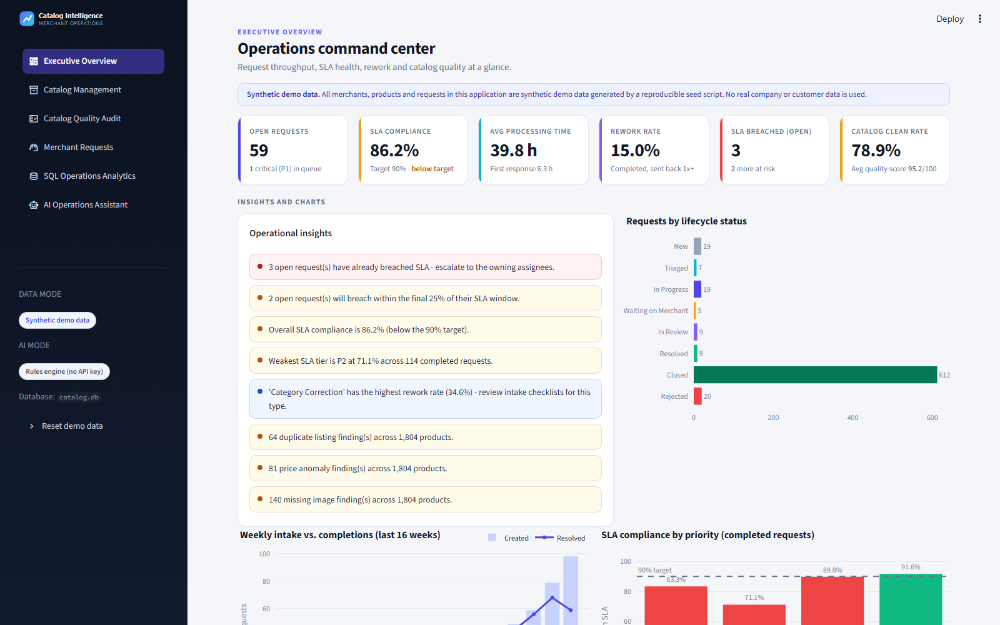 | 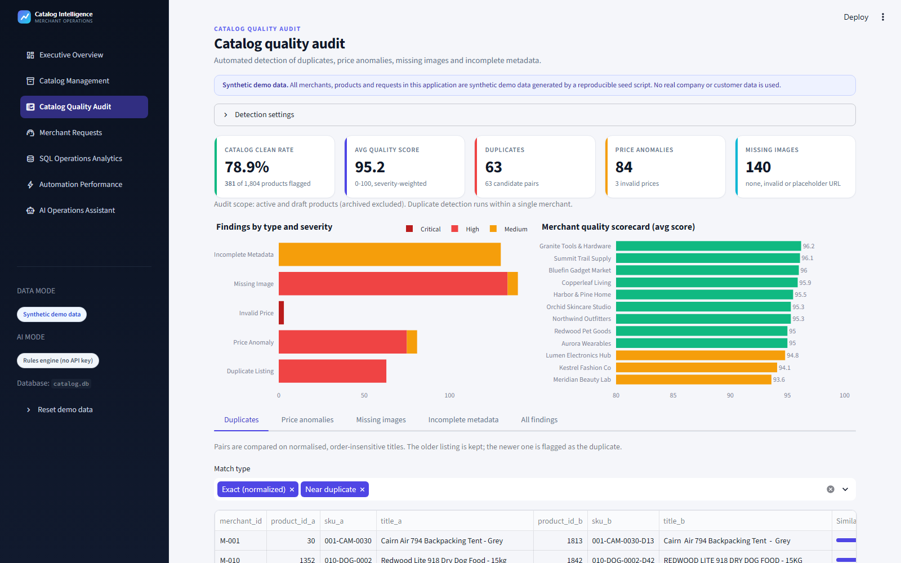 |

| Catalog Management - XLSX/CSV upload validation | Merchant Requests - detail and lifecycle |
| --- | --- |
|  |  |

| New request - live classification | SQL Analytics - verification |
| --- | --- |
| 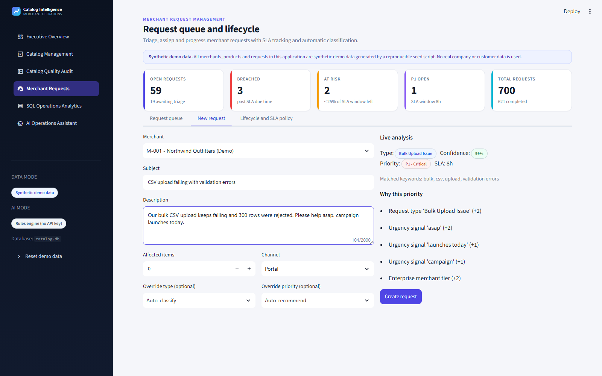 | 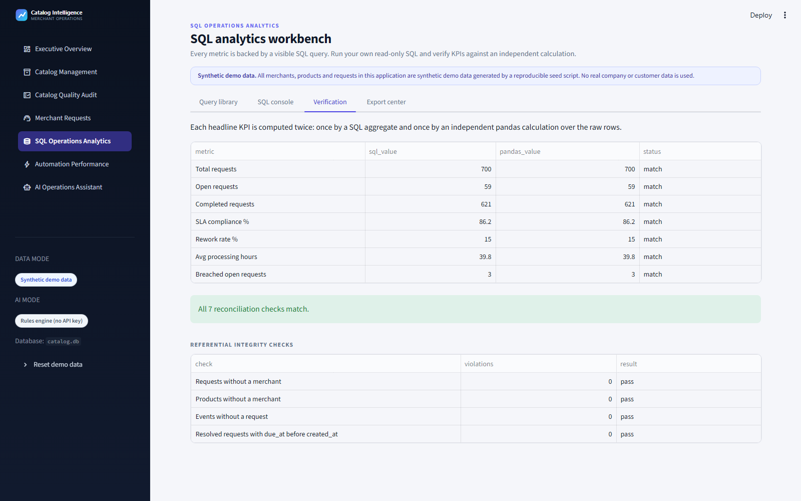 |

| AI Assistant | LLM usage / cost log (no key configured) |
| --- | --- |
| 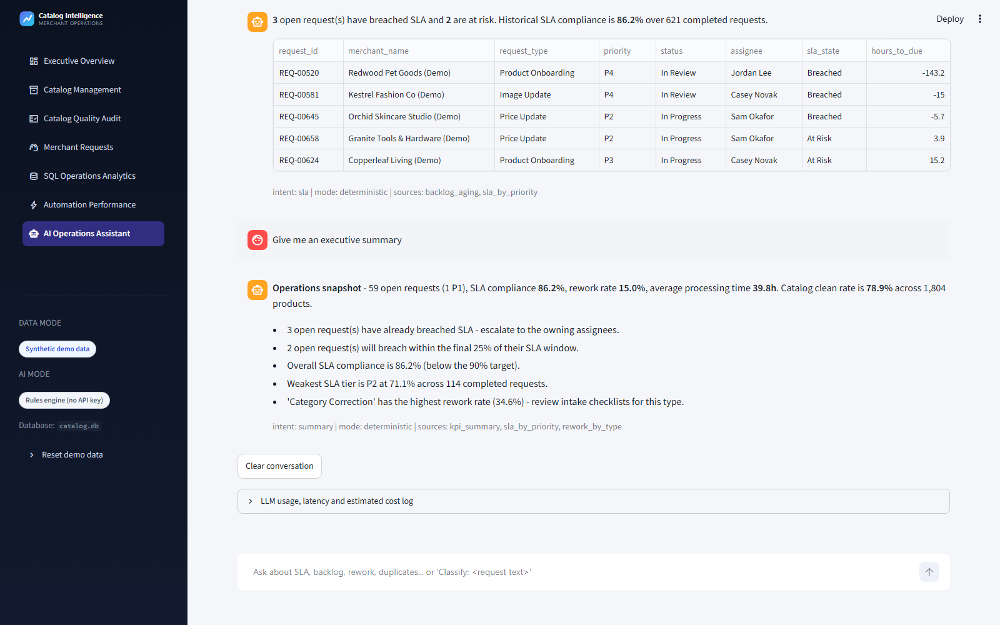 | 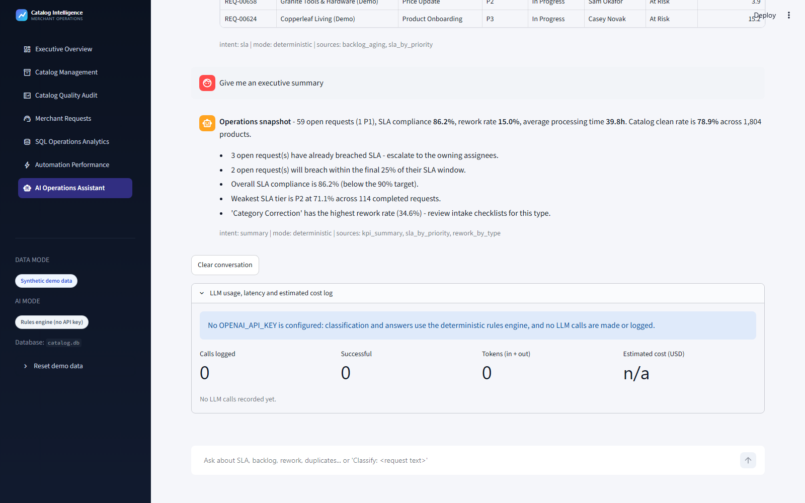 |

| Automation Performance - before / after | Automation Performance - run and results |
| --- | --- |
| 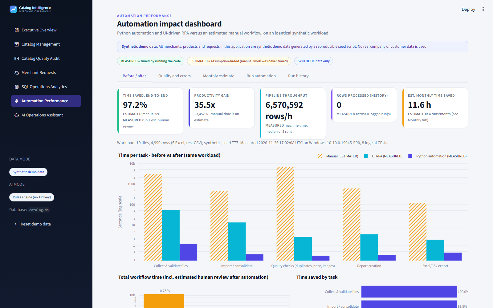 | 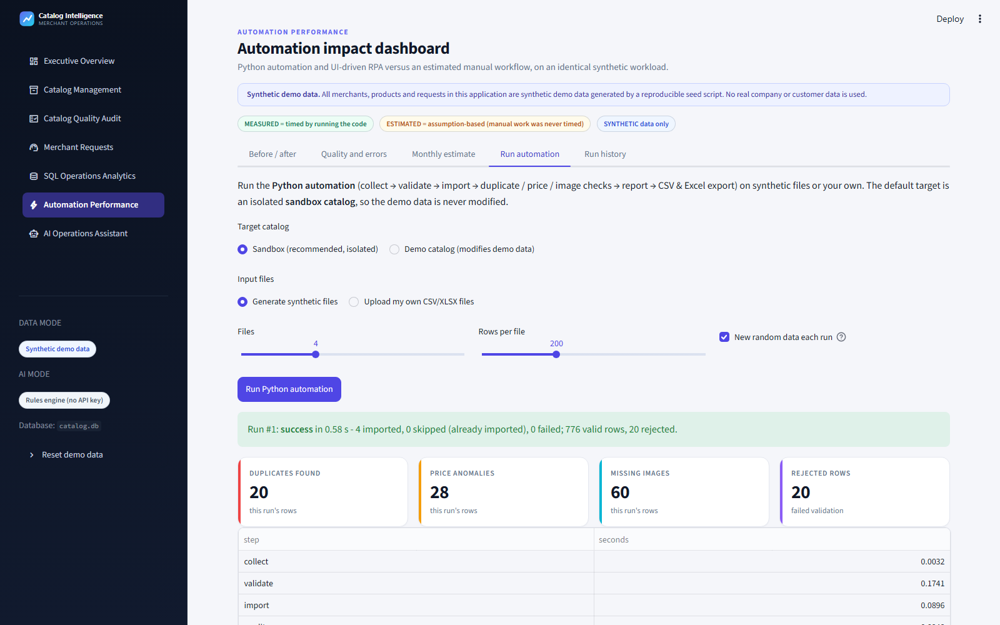 |

| Automation - quality and errors | Automation - run history |
| --- | --- |
| 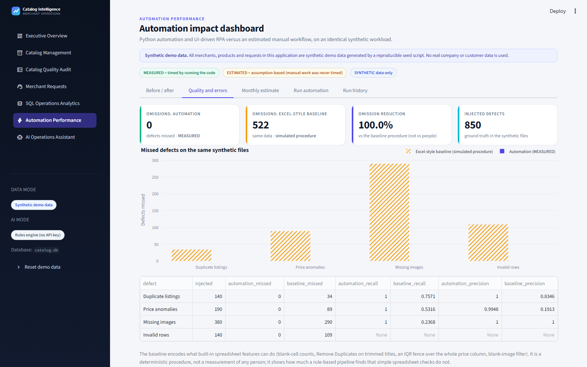 | 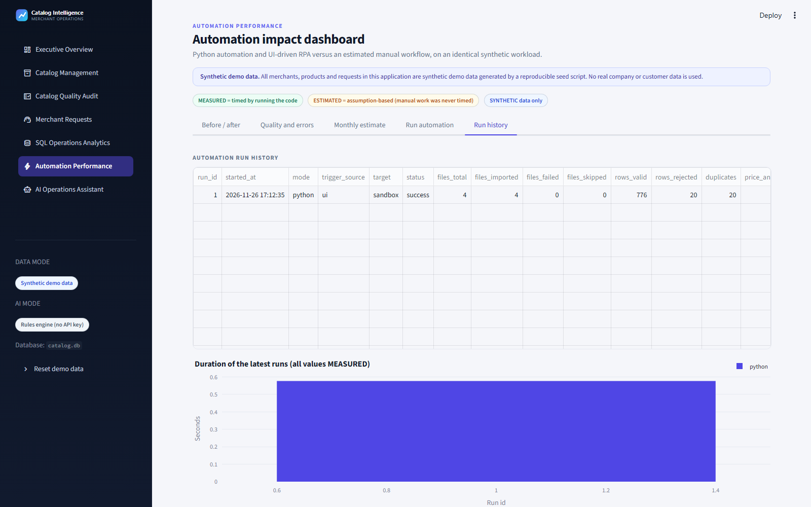 |

More: [Monthly estimate calculator](docs/screenshots/07c_automation_monthly.png), [Catalog Management](docs/screenshots/02_catalog_management.png), [Merchant Requests queue](docs/screenshots/04_merchant_requests.png), [SQL query library](docs/screenshots/05_sql_analytics.png).

## Run it

Requires Python 3.10+.

```bash
python -m venv .venv
source .venv/Scripts/activate        # Windows Git Bash. macOS/Linux: source .venv/bin/activate. Windows cmd: .venv\Scripts\activate
pip install -r requirements.txt
streamlit run app.py                 # opens http://localhost:8501
```

The first start creates `data/catalog.db` and seeds it automatically (about 1,900 products, 700 requests, 12 merchants). Demo data older than 3 days is regenerated on start so open requests are always measured against a realistic "now". The sidebar has **Reset demo data**.

### Demo walkthrough (about 5 minutes)

1. **Executive Overview** - read the KPI cards and the insights panel (3 SLA breaches, weakest tier, highest rework type). Click *Executive report (Excel)* or *(HTML)*.
2. **Catalog Quality Audit** - open *Detection settings* and move the sliders; open the *Duplicates*, *Price anomalies* and *Missing images* tabs; export findings as CSV or Excel.
3. **Catalog Management -> Upload CSV / Excel** - download the *Excel template*, change a price to `abc` and delete a SKU, upload it, read the row-level errors, then click *Import*. Switch to *Browse catalog*, search the SKU and export it as Excel.
4. **Merchant Requests -> New request** - type a subject such as `CSV upload failing with validation errors` and a description mentioning `300 rows` and `asap`; the live analysis shows type, confidence, priority and the reasons. Create it, then in *Request queue* select it and move it through *Triaged -> In Progress -> In Review*; move it back to *In Progress* to see rework counted.
5. **SQL Operations Analytics** - pick a query in the library (SQL is shown beside the chart), run your own `SELECT` in the console, and open *Verification* (SQL vs pandas reconciliation).
6. **AI Operations Assistant** - click the example prompts, or type `Classify: our feed sync failed overnight, urgent`. Open the *LLM usage log* panel.

## Features

| Area | What it does |
| --- | --- |
| **Executive Overview** | KPI cards, rule-based insights, status funnel, weekly throughput, SLA by priority, P50/P90 processing time, rework by type, merchant leaderboard, HTML and Excel executive reports. |
| **Catalog Management** | Filter/search catalog (first 2,000 matches displayed; exports cover all rows); **CSV and XLSX upload** with row-level validation; upsert import with upload history; single-product form; CSV/Excel exports. |
| **Catalog Quality Audit** | Duplicate detection (exact-after-normalisation and near-duplicate, within a merchant), price anomalies (median/MAD z-score on log price per category, plus invalid prices), missing/invalid/placeholder images, incomplete metadata, quality scores, adjustable thresholds, CSV/Excel export. |
| **Merchant Requests** | Queue with SLA state; classification into 8 types; priority recommendation (P1-P4) with reasons; lifecycle with enforced transitions and event timeline; assignment; rework counting. |
| **SQL Operations Analytics** | 10-query library with visible SQL, read-only SQL console, KPI verification (SQL vs pandas), integrity checks, export center. |
| **Automation Performance** | Before/after charts (manual ESTIMATED vs Python and UI-RPA MEASURED), per-task savings, detection omissions vs an Excel-style baseline, monthly-savings calculator with editable assumptions, a **Run automation** panel (synthetic or your own files, sandbox by default) and the run history. |
| **AI Operations Assistant** | Chat over live analytics (summary, SLA risk, backlog, rework, processing time, duplicates, prices, images, quality, `Classify:` triage) with sources shown; LLM usage/cost log. |

### Automation and measured impact

Full design, decision rule (Python vs RPA), assumptions and method: [`docs/automation.md`](docs/automation.md). Raw results: [`docs/automation/measurements.md`](docs/automation/measurements.md) / `.json`. Everything is **synthetic data**.

```bash
python scripts/run_automation.py --inbox data/automation/inbox            # Python automation; imported files move to processed/, bad ones to failed/
python scripts/rpa_ui_bot.py --url http://localhost:8501 --inbox <dir> --out-dir <dir>   # UI RPA (use a throw-away CATALOG_DB_PATH)
python scripts/measure_automation.py                                       # re-measure (about 10 minutes incl. 100k-row scale test)
```

Workload (identical for every mode): 10 merchant files (5 XLSX), 4,990 rows, injected defects 140 duplicates / 190 price anomalies / 380 missing images / 140 invalid rows.

| Basis | Result on this workload |
| --- | --- |
| **MEASURED** - Python automation, median of 5 runs | 2.7 s of machine time (collect+validate 1.2, import 0.4, quality 0.3, report 0.3, export 0.4), peak 109 MB |
| **MEASURED** - UI RPA through a real browser, median of 2 runs | 73.7 s (a lower bound for a manual click-through: no human reading/thinking time) |
| **ESTIMATED** - manual Excel-assisted work (unit-time assumptions in `docs/automation.md`) | 10,752 s (about 3.0 h) |
| **ESTIMATED** end-to-end saving: manual vs automated machine time + 300 s human review | **97.2%** time saved, **35.5x** (+3,452%) productivity |
| Machine-time-only comparison (not the headline, ignores the human review) | 99.98%, about 4,000x |
| **ESTIMATED** monthly time saved | 11.6 h at 4 runs/month; 58.1 h at 20 runs/month |
| **MEASURED** omissions vs an Excel-style baseline *procedure* (simulated, not people) | automation missed 0 of 850 injected defects; the baseline procedure missed 522 (-100% omissions) |
| **MEASURED** scale test, 99,992 rows in 8 files | 33.7 s (2,968 rows/s), peak 441 MB |

Read the manual and monthly figures as "what the stated assumptions imply", not as realised savings: no person was timed, and real defect rates differ from the injected ones. Automation detected every injected defect on this synthetic data; that is a statement about this generator, not about real catalogs.

### Excel support

- **Upload**: `.xlsx` only (legacy `.xls` is rejected with a clear message). The first sheet is read in openpyxl read-only mode with `data_only=True`, so **formulas are never evaluated** (a formula cell without a cached value is treated as empty and fails validation). Limits: 5 MB file, 20,000 rows, 100 MB uncompressed (zip-bomb guard). Numeric SKUs (`12345.0`) are normalised. Other sheets are ignored with a warning.
- **Download**: every table has *CSV* and *Excel* buttons (generated on click, not on every rerun), plus a multi-sheet *Executive report (Excel)*. Text cells are stored as strings, so `=...` values stay inert text instead of becoming formulas. Excel buttons are disabled above 50,000 rows (CSV remains available) because writing 100,000 rows took about 50 s in the measurements.
- The 5 MB limit is reached before the 20,000-row limit for realistic rows: a 20,000-row CSV of the synthetic shape is 5.43 MB (measured), so about 18,000 such rows is the practical maximum.

### AI-assisted classification

`classifier.classify_request()` tries an optional LLM (`catalog_intel/ai.py`, OpenAI-compatible, standard library only) **only if** `OPENAI_API_KEY` is configured. Output is strictly validated (allowed type, confidence in 0-1). A missing key, HTTP/network error, timeout, malformed payload, invalid output or reaching the daily cap all fall back to the deterministic keyword-scoring model; with no key the sidebar shows **Rules engine (no API key)** and no LLM call is ever made.

**Call logging and cost** (designed for audit, tested with mocks and a local HTTP server):

- Every attempt becomes a row in `llm_call_log`: timestamp, purpose, model, status (`ok` / `error` / `invalid_output` / `skipped_daily_cap`), latency, prompt/completion tokens, **estimated** cost, short error label. Prompts, responses and API keys are never stored (tested).
- Cost = tokens x per-token price. The built-in table (gpt-4o-mini, gpt-4o, gpt-4.1-mini) was taken from OpenAI's public pricing page on 2026-11-26; override with `OPENAI_PRICE_INPUT_PER_1M` / `OPENAI_PRICE_OUTPUT_PER_1M`. Unknown model without override => cost stored as NULL, never guessed. Treat all figures as estimates, not invoices.
- `OPENAI_MAX_CALLS_PER_DAY` (default 200 per server process) bounds spend on a public demo.
- The log is visible in the Assistant page and queryable in the SQL console (`SELECT * FROM llm_call_log`).
- Default model is `gpt-4.1-mini`; OpenAI's docs list `gpt-4o-mini` as deprecated. Whether your key can use the default model is only known after a live call, so set `OPENAI_MODEL` if needed.

**Verify with a real key** (costs a few cents at most):

```bash
OPENAI_API_KEY=sk-... python scripts/verify_llm.py          # ping + 16 held-out requests -> docs/performance/llm_verification_*.json
OPENAI_API_KEY=sk-... python -m pytest tests/test_llm_live.py -v -s
```

Without a key both are skipped and say so (`scripts/verify_llm.py` writes a `skipped_no_api_key` record, `--require-key` makes it fail instead). **At the time of writing no real LLM call has been made.**

### Rule-based accuracy (synthetic, optimistic)

100% on the 700 synthetic labeled requests (the seed templates share the rules' vocabulary) and 16/16 on a small hand-written held-out set written by the same author (`catalog_intel/evalset.py`). Real-world accuracy will be lower.

## Performance at 100,000 records (measured)

Full tables, JSON and the machine description are in [`docs/performance/`](docs/performance/SUMMARY.md). Measured on one Windows PC (8 logical CPUs, 16 GB RAM, Python 3.10, pandas 2.3, SQLite 3.37), single run, wall-clock time, memory = process RSS sampled every 20 ms. Streamlit Community Cloud will be slower.

| Measure (100,000 products, 50,000 requests, 316,221 events) | Result |
| --- | --- |
| Full catalog quality audit (`run_audit`) | **8.3 s**, peak RSS 383 MB |
| Duplicate detection alone | 4.8 s (precision 1.0, recall 1.0 vs injected ground truth) |
| Price anomaly detection | 0.38 s (recall 0.999, precision 0.959) |
| Missing-image detection | 1.9 s (recall 0.973, precision 0.966) |
| Analytics SQL queries | 5 ms - 1.35 s median (slowest: `stage_durations`, a window function over 316k events) |
| Product-level SQL (group by, join, window) | 0.1 - 0.55 s; indexed SKU lookup 0.03 ms |
| Process peak RSS over the whole benchmark | 417 MB |
| 15,000-row upload: validate CSV / XLSX / import | 0.7 s / 5.4 s / 0.6 s |
| Export all 100,000 rows: CSV / XLSX | 2.2 s / 49.7 s |
| SQL-vs-audit cross-checks (missing images, invalid prices, KPI reconciliation) | all match |

Streamlit page render (server-side script time, AppTest; excludes browser rendering): 0.2-3.7 s warm per page (most pages 2-4 s), 21.6 s for the very first Overview load (imports plus the 8 s audit).

**Before/after optimization** (same data): the original duplicate matcher compared all pairs inside each (merchant, brand, category) block. At 10,000 rows the audit took 7.5 s, at 25,000 rows 29.5 s (about quadratic), so 100,000 rows was not run on the old code; extrapolating suggests many minutes. Blocking additionally by the set of numbers in the title (titles with different numbers can never match) and rejecting near-matches whose differing words are not typos brought the audit to 0.6 s / 1.6 s at 10k / 25k, **8.3 s at 100k**, and raised duplicate precision at 25k from 0.83 to 1.0 (the old matcher flagged "Pro" vs "Max" variants). A test proves the fast search finds exactly the same pairs as an exhaustive search.

**Demo data and performance data are separate.** The app only ever uses `data/catalog.db` (about 1,900 products). Large data lives in `data/perf/*.db` (git-ignored). `catalog_intel.perf.assert_not_demo_db` makes the generator, `scripts/benchmark.py` and `scripts/benchmark_ui.py` refuse the demo database; the UI benchmark works on a temp copy.

```bash
python scripts/benchmark.py --products 100000 --requests 50000 --label optimized   # about 3-4 minutes
python scripts/benchmark_ui.py --db data/perf/perf_100000.db
python scripts/summarize_benchmarks.py                                             # rewrites docs/performance/SUMMARY.md
```

Do not point the running app (`CATALOG_DB_PATH`) at a performance database: the demo auto-refresh would regenerate it after 3 days.

## Seed scripts

```bash
python scripts/seed_data.py                                   # demo data, as-of now
python scripts/seed_data.py --seed 7 --as-of "2026-01-15 12:00:00" --db data/other.db
```

The same `(seed, as_of)` always produces identical data (tested). Defects (duplicates, price anomalies, missing images) are injected at known rates so detectors can be scored against ground truth.

## Tests

```bash
pip install -r requirements-dev.txt
python -m pytest -q
```

Current result: **213 passed, 2 skipped** in about 3 minutes (the 2 skipped are the live-LLM tests that need `OPENAI_API_KEY`). All 168 tests from earlier iterations still pass; 45 were added for automation (pipeline, idempotency, crash recovery, DB integrity: 22), KPI formulas and measurement-file consistency (14), privacy/secret scans (6), real-browser RPA (2) and the dashboard (1). The RPA tests start a throw-away Streamlit server and need Playwright Chromium (`python -m playwright install chromium`); they skip themselves if it is missing. Coverage includes: classification and priority, CSV/XLSX validation edge cases, detectors vs ground truth, lifecycle/SLA, SQL-vs-pandas reconciliation, SQL console safety, formula-injection-safe CSV and XLSX output, seed reproducibility, an equivalence test between the optimized and exhaustive duplicate search, a small end-to-end run of the benchmark script, and headless rendering of all pages (Streamlit `AppTest`).

Real-browser check of Excel (needs a running app and Playwright Chromium): `python scripts/e2e_excel_check.py --url http://localhost:8501` (imports one product, so use a throwaway `CATALOG_DB_PATH`).

## Architecture

See [docs/architecture.md](docs/architecture.md) for component, ER and lifecycle diagrams.

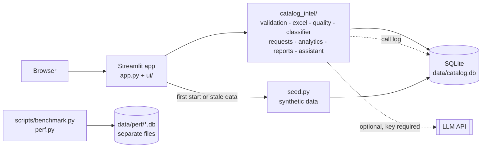

```
app.py                  Streamlit entry point (st.navigation, theme, sidebar)
ui/                     One module per page + shared theme/components/download helpers
catalog_intel/          Business logic - no Streamlit imports, unit-tested
  config.py db.py seed.py perf.py validation.py excel.py quality.py classifier.py ai.py
  evalset.py requests_mgmt.py analytics.py reports.py assistant.py
  automation.py workload.py baseline.py roi.py   (automation pipeline, synthetic workload, Excel-style baseline, KPI formulas)
scripts/                run_automation.py, rpa_ui_bot.py, measure_automation.py, seed_data.py, benchmark.py, benchmark_ui.py, summarize_benchmarks.py,
                        verify_llm.py, capture_screenshots.py, e2e_excel_check.py
tests/                  pytest suite;  docs/performance/ measured results;  docs/screenshots/
.streamlit/             config.toml (theme) + secrets.toml.example
```

## Security and data handling

- No credentials or secrets are committed. `.streamlit/secrets.toml` and `.env*` are git-ignored; only `secrets.toml.example` is tracked. The LLM log never contains keys, prompts or responses.
- All SQL uses bound parameters; the SQL console accepts one `SELECT`/`WITH`, runs on a `mode=ro` connection with `PRAGMA query_only`, and caps results at 1,000 rows.
- Uploads: 5 MB / 20,000-row limits, control characters stripped, strict field validation, XLSX opened read-only with formulas not evaluated and a decompression-size guard.
- CSV exports escape cells beginning with `=`, `+`, `-`, `@`; XLSX exports store text as strings. HTML report content is escaped.
- The demo has **no authentication by design**. Do not load real merchant data into a public deployment.

## Deployment to Streamlit Community Cloud

Deployed at **https://merchant-catalog-intel.streamlit.app** (repository `purinLee/my-project`, branch `main`, main file `app.py`, no secrets). The app is created as *private* by default; it was switched to *public and searchable* in the app's Sharing settings so it can be opened without login. Resource limits, the persistence analysis and the checklist are in [`docs/deployment.md`](docs/deployment.md).

Verified on the live URL with a fresh anonymous Playwright browser (no cookies, same PC and network): first load 11 s; all 7 pages render without errors; XLSX upload validated and Excel download opened with openpyxl (1,804 rows); *Run Python automation* (sandbox) finished in about 2 s, reported "success, 4 imported" and the ZIP download contained 8 files; the run appeared in the history. **Restart test:** after *Reboot app* the run history was empty again, so SQLite data is **not** persisted across restarts (use an external database if persistence is required, see `docs/deployment.md`). **Not tested:** a real smartphone and a second physical PC; a Chromium iPhone-13 emulation showed no horizontal overflow and no page errors, but on the first deployment the sidebar opened over the content on narrow screens, which is why `initial_sidebar_state` was changed to `auto`. Steps used:

1. Push the repository to GitHub.
2. At [share.streamlit.io](https://share.streamlit.io) create an app, choose the repository/branch, set **Main file path** to `app.py` (Python 3.10-3.12; dependencies come from `requirements.txt`, which now includes `openpyxl`; Streamlit >= 1.52 is required for deferred downloads).
3. Secrets are optional (`OPENAI_API_KEY` and the other keys in `.streamlit/secrets.toml.example`).
4. The database is created and seeded on the first request. The Community Cloud filesystem is ephemeral: uploads, edits and the LLM log reset on restart.

## Known limitations

- SQLite on an ephemeral filesystem: UI-written data is not durable on Community Cloud; concurrent writers are serialised.
- **LLM path never exercised against a live provider**; the default model name is unverified; cost figures are estimates; the daily cap is per server process and resets on restart.
- Performance numbers come from one local machine and one run each; the 100,000-row dataset uses only 12 merchants (about 8,300 products each), which is a deliberate stress case for per-merchant duplicate detection but not a real marketplace distribution. The synthetic titles share a rigid structure, so detector precision/recall on real catalogs will differ.
- Excel: first sheet only, `.xlsx` only; writing is slow for very large tables (about 50 s per 100,000 rows) and the UI disables it above 50,000 rows.
- The 5 MB upload limit caps uploads at roughly 18,000 rows of typical width.
- Duplicate detection works within one merchant and compares titles only. Price anomalies use a statistical rule and can flag legitimate premium or clearance products.
- SLA uses calendar hours (no business calendar, no pause while waiting on the merchant).
- Rule-based classifier is English-only and keyword-driven.
- Manual-time figures and everything derived from them (time saved %, productivity, monthly hours) are assumption-based estimates; no analyst was timed. The Excel-style baseline is a simulated procedure.
- The UI RPA bot depends on page structure (selectors); it is retried and waits for widgets, but a UI redesign would require updating it. It must only be pointed at throw-away databases.
- Automation runs on Streamlit Cloud use shared, ephemeral storage and slower CPUs than the measured PC; the hosted button is limited to small synthetic runs.
- No authentication or per-user audit identity (the "acting as" field is free text).
