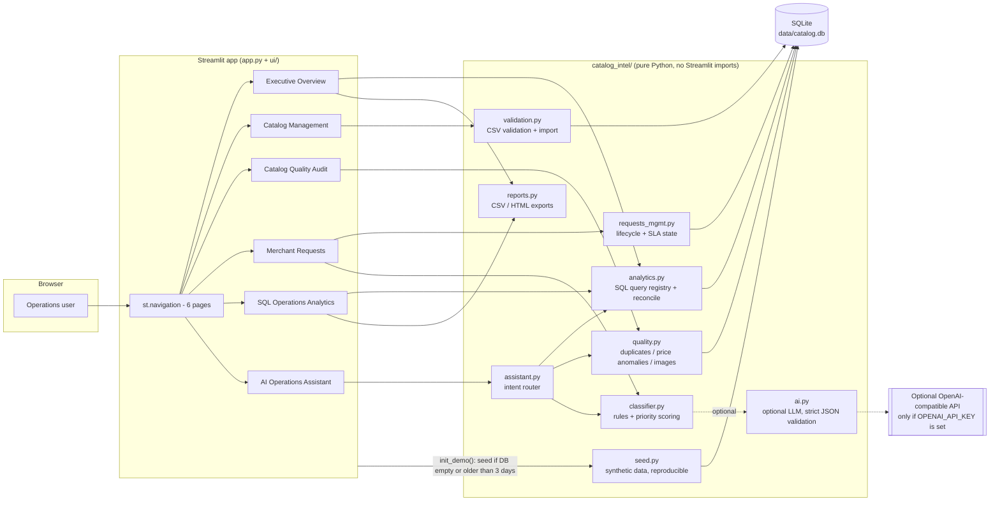
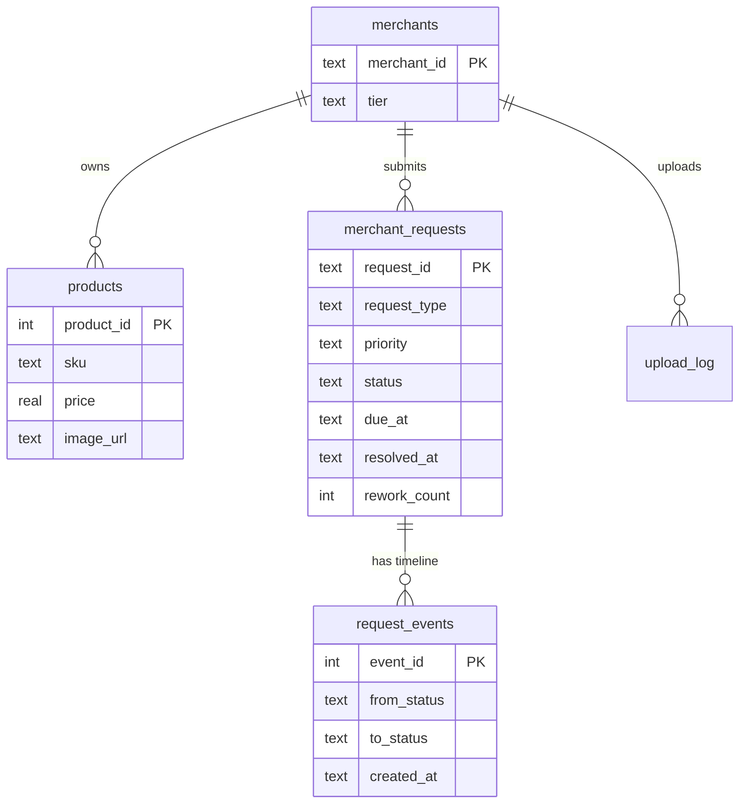
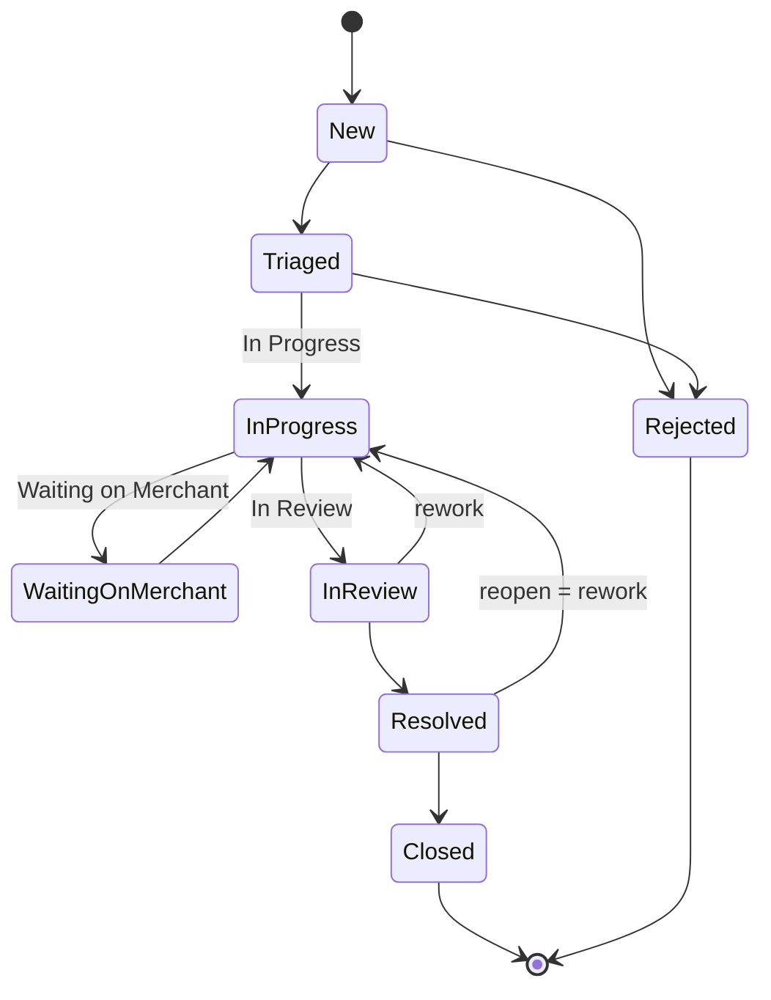

# Architecture

## Data model

## Request lifecycle

## Key design decisions

| Decision | Reason |
| --- | --- |
| Business logic in `catalog_intel/` with no Streamlit imports | Unit-testable without a UI; UI stays thin. |
| SQLite file, auto-seeded on first start | Zero infrastructure; works on Streamlit Community Cloud. |
| `now` is always a parameter (`:now`) | Deterministic tests and reproducible SQL results. |
| Rules-first classification, LLM optional | The app must work with no external API or secret. LLM output is strictly validated and falls back on any failure. |
| Read-only SQL console (validator + `mode=ro` connection + `query_only`) | Defence in depth: three independent layers prevent writes. |
| Median/MAD z-score on log-price per category | Robust to the outliers it is hunting; symmetric for too-high and too-low prices. |
| Titles with different numbers are never duplicates | Avoids flagging "Pro 500" vs "Pro 510" or "128GB" vs "256GB". |
